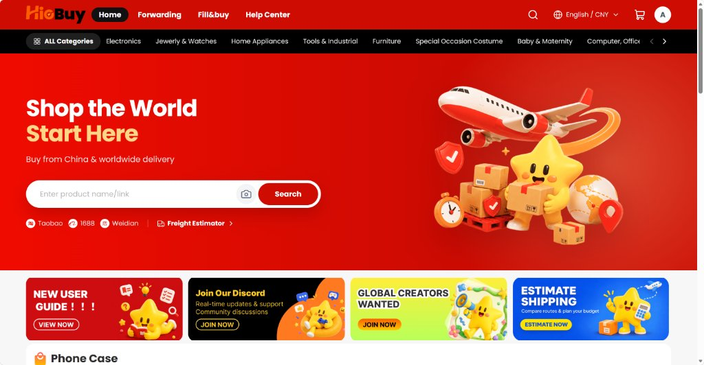
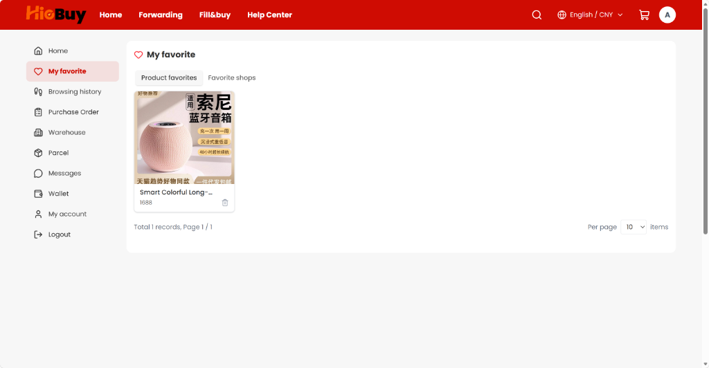
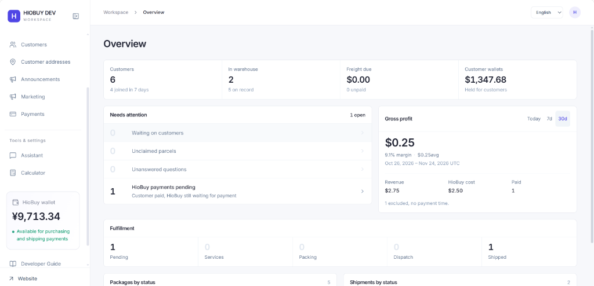

# HioBuy Store


English | [简体中文](README.zh-CN.md)

**Open-Source Cross-Border Shopping Agent, Parcel Forwarding & Consolidation Platform**

HioBuy Store is a self-hosted, white-label platform for running a China-based cross-border procurement (buying agent) and parcel forwarding business on Cloudflare Workers. You own the storefront, customer accounts, selling prices, coupons, and customer payments; physical warehouse receiving, packing, and international shipping are powered by the [HioBuy Fulfillment API](https://hiobuy.com/en/api-docs/fulfillment-setup) and HioBuy procurement APIs.

**[Hiobuy Store Demo](https://store.demo.hiobuy.com/)** · **[Documentation](docs/README.md)** · **[HioBuy Developer Portal](https://developers.hiobuy.com)** · **[Fulfillment API Docs](https://hiobuy.com/en/api-docs/fulfillment-setup)**

> **Note:** HioBuy Store is a customer commerce and operations platform, **not** a warehouse management system (WMS). Read the [Production Checklist](docs/getting-started/production.md) and [Security Policy](SECURITY.md) before accepting real customers.

## Key Features

**Storefront & Member Center (Web Worker)**
- **Cross-border shopping**: Keyword search, product URL parsing, image search, category browsing, SSR product pages, unified cart, catalog & manual purchase orders ("Fill & Buy"), and coupons.
- **Forwarding & consolidation**: Synced China warehouse address with member code, batch pre-alerts, claims, exception responses, warehouse photos/videos, live-quoted consolidation, and public freight estimator (`/freight-estimation`).
- **Payments, account & i18n**: Better Auth (email verification, Google OAuth, Turnstile), USD wallet (Stripe Checkout & multi-account bank transfers), PDF shipping documents, Workers AI assistant, and 12-language `next-intl` localization (including RTL Arabic).

**Admin Console (`/admin`)**
- **Procurement & marketing**: Order review, upstream HioBuy submission/payment (optional 2FA), reconciliation, domestic tracking, product categories/pricing/search cache, and coupons/campaigns.
- **Warehouse & logistics**: Package and shipment sync (manual pulls + signed webhooks), warehouse VAS catalog & applications, `HioBuy Pay` (with optional TOTP 2FA), cancellation/interception, and customer address management.
- **Finance, email & staff**: Global freight markup, unified exchange rates, immutable cost/profit snapshots, Stripe & bank top-up review/refunds, SMTP & Cloudflare Email Sending templates, invite-only staff RBAC (`/admin/invite`), Client API allowlist & OpenAPI docs, and built-in Developer Guide (`/admin/guide`).

## Live Demo & Screenshots

Try the live deployment at **[Hiobuy Store Demo](https://store.demo.hiobuy.com/)**. When `DEMO_MODE=true` is enabled, signed-in users can explore the read-only Demo Admin at `/admin/demo` with sample data (no real financial charges or warehouse shipments are created).

**Storefront** — Public shopping and forwarding storefront served by the Web Worker.



**Member Center** — Sidebar navigation for favorites, browsing history, purchase orders, warehouse packages, parcels, messages, wallet, and account settings.



**Admin Console** — Operator overview with queues, gross profit, fulfillment progress, and the HioBuy wallet balance.



## Architecture & Stack

Two Cloudflare Workers share one custom domain:

```text
Browser / Client
  ├── /*                → Web Worker (hiobuy-procurement-website)
  │                         Next.js 16 App Router (vinext) + client-mounted /admin SPA
  │                         └─ SSR → `API` Service Binding (dev: API_INTERNAL_ORIGIN)
  └── /api/*, /agents/* → API Worker (hiobuy-procurement)
                            Hono + Better Auth + Cron (* * * * *)
                            ├─ Cloudflare D1 (Drizzle ORM), R2, Durable Objects, Workers AI
                            └─ server/services/hiobuy/ → HioBuy Fulfillment & Procurement APIs
```

- **Frontend**: Next.js 16 (vinext / Vite), TypeScript 5.9, Tailwind CSS v4, shadcn/ui, Zustand, next-intl 4.14.9; Admin SPA with React 19, React Router, TanStack Query.
- **Backend & Infra**: Hono on Cloudflare Workers, D1 + Drizzle ORM, R2, Durable Objects (`ForwardingAssistant`), Workers AI, Zod, Better Auth, Stripe, SMTP / Cloudflare Email Sending, Vitest.

## Quick Start

### Prerequisites

- **Node.js 22.12+** and npm
- **`HIOBUY_API_TOKEN` is required**: Apply for a developer account and API key at the **[HioBuy Developer Portal](https://developers.hiobuy.com)** before running the platform (product search, procurement, warehouse address sync, and live shipping quotes all require a valid HioBuy API key; see [HioBuy Developer Account](docs/getting-started/developer-account.md) and [API Key & Warehouse Authorization](docs/getting-started/api-key.md)).

### Run Locally

```bash
git clone https://github.com/hiobuy/open-source-store.git
cd open-source-store
npm ci
cp .dev.vars.example .dev.vars
cp .env.example .env
```

Edit `.dev.vars` and set the required variables:
- `BETTER_AUTH_SECRET`: generate via `openssl rand -base64 32`
- `ADMIN_EMAILS`: email for promoting the initial owner
- `HIOBUY_API_TOKEN`: your API key from the [HioBuy Developer Portal](https://developers.hiobuy.com) (required; can also be managed encrypted in **Settings → Integration**)

Start both Workers in two terminals:

```bash
npm run dev:api   # Terminal 1: applies local D1 migrations & starts API Worker on 127.0.0.1:8787
npm run dev       # Terminal 2: starts Web Worker (vinext) and proxies /api/* to 8787
```

Register on `/register` with your `ADMIN_EMAILS` address (without SMTP, check `GET /api/dev/mailbox?email=...` in dev), then sign in at `/admin/login` to open `/admin`, sync your warehouse & destinations, and configure pricing.

### Deploy to Cloudflare Workers

1. **Provision Cloudflare resources** (requires a Cloudflare account with Workers, D1, R2, Durable Objects, Workers AI, and a proxied custom domain):
   - **D1 database**: `npx wrangler d1 create hiobuy-procurement` (save the returned `database_id`)
   - **R2 bucket**: `npx wrangler r2 bucket create hiobuy-procurement-photos`
   - **Custom domain**: add your domain to Cloudflare DNS with proxy (orange cloud) enabled (`workers.dev` is disabled on the Web Worker)
   - *(Optional)* Enable **Cloudflare Email Sending** if sending via `smtp.mx.cloudflare.net` instead of external SMTP.

2. **Configure `wrangler.jsonc` for production** (recommended: copy `wrangler.jsonc` to gitignored `wrangler.local.jsonc` so real IDs are never committed; or pass `CLOUDFLARE_D1_DATABASE_ID` in CI):
   - Update `env.production.d1_databases[0].database_id` from the placeholder `00000000-0000-0000-0000-000000000000` to your real D1 `database_id`.
   - If you rename `env.production.name`, `database_name`, or `bucket_name`, keep `cloudflare.config.ts` (or `API_WORKER_NAME` / `WEB_WORKER_NAME`) aligned so the Web Worker's `API` service binding matches.

3. **Set production secrets** on the API Worker:

   ```bash
   npx wrangler secret put BETTER_AUTH_SECRET --env production -c wrangler.local.jsonc
   npx wrangler secret put ADMIN_EMAILS --env production -c wrangler.local.jsonc
   npx wrangler secret put APP_URL --env production -c wrangler.local.jsonc           # e.g. https://store.example.com
   npx wrangler secret put HIOBUY_API_TOKEN --env production -c wrangler.local.jsonc  # from developers.hiobuy.com
   ```

4. **Migrate and deploy** (**always deploy the API Worker before the Web Worker**):

   ```bash
   npm run db:migrate:remote
   npm run deploy:api
   npm run deploy:web
   ```

5. **Add custom-domain Routes** in the Cloudflare Dashboard: route `<your-domain>/api/*` and `<your-domain>/agents/*` to the **API Worker**, and `<your-domain>/*` to the **Web Worker**. See [Deploy & Environment](docs/getting-started/deploy.md) for full details.

## Documentation

| Document | Contents |
| --- | --- |
| [Documentation Index](docs/README.md) | Complete map of repository docs |
| [Local Development](docs/development.md) | Setup, commands, layout, routes, and API conventions |
| [Deploy & Environment](docs/getting-started/deploy.md) | Environment variables, dual-Worker routing, and deployment steps |
| [Production Checklist](docs/getting-started/production.md) | Pre-launch checklist and known limitations |
| [Storefront Guide](docs/storefront.md) | Web Worker conventions, same-origin API, theme, i18n, and SVG |
| [Architecture & Implementation](docs/architecture.md) | Dual ledgers, pricing/profit formulas, staff RBAC, and boundaries |
| [Developer Guide](docs/guide.md) | Full workflows, statuses, customization, and troubleshooting (also at `/admin/guide`) |
| [Security Policy](SECURITY.md) | Security checklist, secret handling, and vulnerability reporting |
| [Changelog](CHANGELOG.md) | Notable changes |

## License

HioBuy Store is licensed under the [Apache License 2.0](LICENSE) (see [NOTICE](NOTICE)). This license does not grant rights to the HioBuy name or logo—replace them with your own branding for commercial operation.
