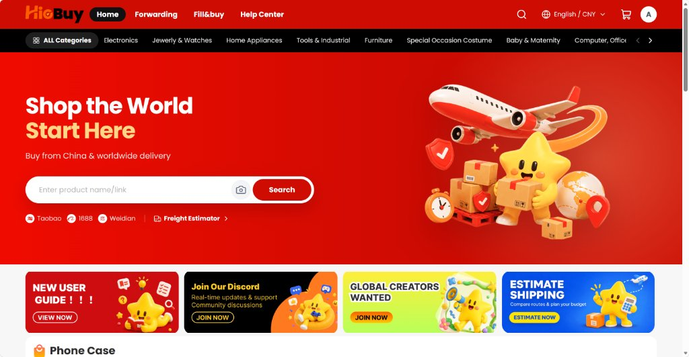
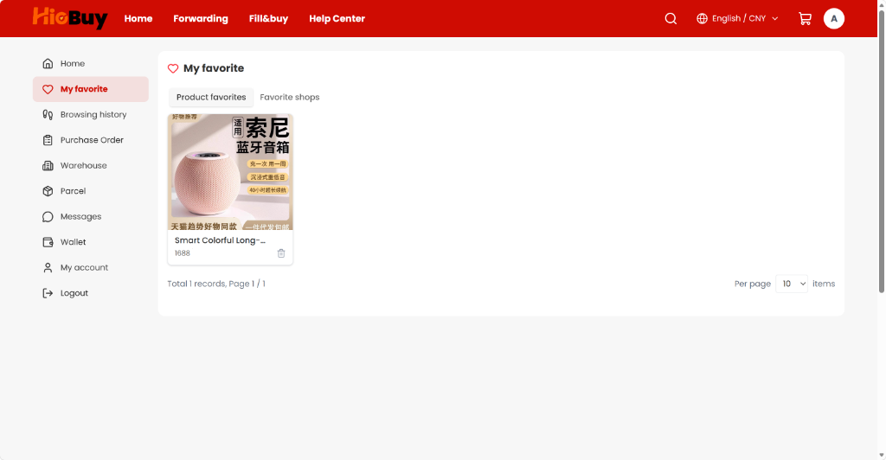
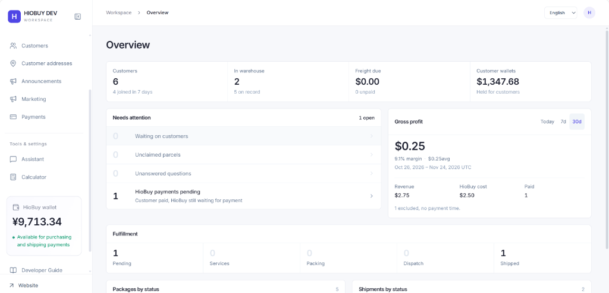

# HioBuy Store


[English](README.md) | 简体中文

**开源跨境代购、包裹转运与合箱平台**

HioBuy Store 是一款可独立部署、支持品牌定制的开源跨境代购与包裹转运平台，基于 Cloudflare Workers 运行。你完全掌控官网商城、客户账号、商品与运费售价、营销优惠及客户收款；上游采购履约、中国仓收货、打包与国际派送由 [HioBuy 履约 API](https://hiobuy.com/en/api-docs/fulfillment-setup) 及 HioBuy 商品/代购 API 提供。

**[Hiobuy Store Demo](https://store.demo.hiobuy.com/)** · **[开发文档](docs/README.md)** · **[HioBuy 开发者中心](https://developers.hiobuy.com)** · **[履约 API 文档](https://hiobuy.com/en/api-docs/fulfillment-setup)**

> **说明：** HioBuy Store 是面向客户的商业与运营平台，**不是**仓库管理系统（WMS）。面向真实客户上线前，请务必阅读 [生产上线清单](docs/getting-started/production.md) 与 [安全策略](SECURITY.md)。

## 核心功能

**官网商城与会员中心（Web Worker）**
- **跨境选品与代购**：关键词搜索、商品链接解析、以图搜图、分类浏览、SSR 商品详情页、统一购物车、目录代购单与手工代购单（填单买）及优惠券。
- **包裹转运与合箱**：同步中国仓地址与会员码、批量包裹预报、无主包裹认领、异常回复、仓库实拍照片/视频、实时报价合箱及公开运费估算页（`/freight-estimation`）。
- **收款、账号与多语言**：Better Auth（邮箱验证、Google 登录、Turnstile）、USD 客户钱包（Stripe Checkout 与多账户银行转账）、PDF 运输单据、Workers AI 客户助手，以及 12 种语言 `next-intl` 本地化（含阿拉伯语 RTL）。

**管理后台（`/admin`）**
- **代购与营销**：代购单审核、提交与支付 HioBuy 上游采购（支持可选 2FA）、异常对账、国内物流追踪、商品分类/定价/搜索缓存及优惠券/活动管理。
- **仓库与物流**：包裹/运单手动拉取与签名 Webhook 同步、仓库增值服务目录与申请、`HioBuy Pay` 履约付款（可选 TOTP 二次验证）、运单取消/拦截及客户地址簿管理。
- **财务、邮件与团队**：全局运费加价、统一汇率、不可篡改成本与利润快照、Stripe 与多账户银行转账审核/退款、SMTP 与 Cloudflare Email Sending 模板队列、纯邀请制员工权限（`/admin/invite`）、外部客户端 API 白名单与 OpenAPI 文档，以及内置开发指南（`/admin/guide`）。

## 在线演示与界面预览

在线体验地址：**[Hiobuy Store Demo](https://store.demo.hiobuy.com/)**。开启 `DEMO_MODE=true` 后，已登录用户可访问只读演示后台 `/admin/demo` 浏览示例数据（不会产生真实扣款或物流下单）。

**官网商城** — 由 Web Worker 提供的对外购物与转运官网首页。



**会员中心** — 集成收藏夹、浏览历史、采购单、仓库、包裹、消息、钱包与账户设置的一站式会员侧栏界面。



**管理后台** — 运营总览，汇总待处理队列、毛利、履约进度和 HioBuy 钱包余额。



## 架构与技术栈

两个 Cloudflare Worker 共享同一个自定义域名：

```text
浏览器 / 客户端
  ├── /*                → Web Worker (hiobuy-procurement-website)
  │                         Next.js 16 App Router (vinext) + 客户端挂载 /admin SPA
  │                         └─ SSR → `API` Service Binding（开发期走 API_INTERNAL_ORIGIN）
  └── /api/*, /agents/* → API Worker (hiobuy-procurement)
                            Hono + Better Auth + Cron (* * * * *)
                            ├─ Cloudflare D1 (Drizzle ORM)、R2、Durable Objects、Workers AI
                            └─ server/services/hiobuy/ → HioBuy 履约与商品/代购 API
```

- **前端**：Next.js 16（vinext / Vite）、TypeScript 5.9、Tailwind CSS v4、shadcn/ui、Zustand、next-intl 4.14.9；管理后台为 React 19、React Router、TanStack Query。
- **后端与基础设施**：Cloudflare Workers + Hono、D1 + Drizzle ORM、R2、Durable Objects（`ForwardingAssistant`）、Workers AI、Zod、Better Auth、Stripe、SMTP / Cloudflare Email Sending、Vitest。

## 快速开始

### 前置条件

- **Node.js 22.12+** 及 npm
- **`HIOBUY_API_TOKEN` 为必填项**：启动前请先前往 **[HioBuy 开发者中心](https://developers.hiobuy.com)** 注册账号并申请 API Key（商品搜索、代购下单、同步中国仓地址及实时运费报价均依赖有效的 HioBuy API Key；详见 [HioBuy 开发者账号](docs/getting-started/developer-account.md) 与 [API Key 与仓库授权](docs/getting-started/api-key.md)）。

### 本地运行

```bash
git clone https://github.com/hiobuy/open-source-store.git
cd open-source-store
npm ci
cp .dev.vars.example .dev.vars
cp .env.example .env
```

编辑 `.dev.vars` 并配置以下必填变量：
- `BETTER_AUTH_SECRET`：通过 `openssl rand -base64 32` 生成
- `ADMIN_EMAILS`：用于提升首位所有者账号的邮箱
- `HIOBUY_API_TOKEN`：在 [HioBuy 开发者中心](https://developers.hiobuy.com) 申请的 API Key（必填；也可在后台 **设置 → 接口集成** 中加密保存）

在两个终端中分别启动两个 Worker：

```bash
npm run dev:api   # 终端 1：执行本地 D1 迁移并在 127.0.0.1:8787 启动 API Worker
npm run dev       # 终端 2：启动 Web Worker（vinext），自动将 /api/* 代理到 8787
```

使用 `ADMIN_EMAILS` 中的邮箱在 `/register` 完成注册（本地未配置 SMTP 时，可通过 `GET /api/dev/mailbox?email=...` 获取验证链接），然后登录 `/admin/login` 进入 `/admin` 同步仓库与目的国并配置定价。

### 部署到 Cloudflare Workers

1. **提前申请并创建 Cloudflare 资源**（需要已开通 Workers、D1、R2、Durable Objects、Workers AI 的 Cloudflare 账号，以及一个接入 Cloudflare DNS 代理的自定义域名）：
   - **D1 数据库**：执行 `npx wrangler d1 create hiobuy-procurement`（记录返回的 `database_id`）
   - **R2 存储桶**：执行 `npx wrangler r2 bucket create hiobuy-procurement-photos`
   - **自定义域名**：将域名解析接入 Cloudflare 并开启小黄云代理（Web Worker 已关闭 `workers.dev`）
   - *（可选）* 如计划通过 `smtp.mx.cloudflare.net` 发信，需同时启用 **Cloudflare Email Sending**。

2. **修改 `wrangler.jsonc` 生产配置**（推荐复制为已被 `.gitignore` 忽略的 `wrangler.local.jsonc` 防止误提交真实 ID；CI 环境也可直接传 `CLOUDFLARE_D1_DATABASE_ID` 等环境变量）：
   - 将 `env.production.d1_databases[0].database_id` 从占位符 `00000000-0000-0000-0000-000000000000` 替换为你上一步创建的真实 D1 `database_id`。
   - 如需修改 `env.production.name`、`database_name` 或 `bucket_name`，同步更新 `cloudflare.config.ts`（或设置 `API_WORKER_NAME` / `WEB_WORKER_NAME`），确保 Web Worker 的 `API` 服务绑定名称一致。

3. **为 API Worker 配置生产 Secrets**：

   ```bash
   npx wrangler secret put BETTER_AUTH_SECRET --env production -c wrangler.local.jsonc
   npx wrangler secret put ADMIN_EMAILS --env production -c wrangler.local.jsonc
   npx wrangler secret put APP_URL --env production -c wrangler.local.jsonc           # 例如 https://store.example.com
   npx wrangler secret put HIOBUY_API_TOKEN --env production -c wrangler.local.jsonc  # 来自 developers.hiobuy.com
   ```

4. **执行远程迁移并按顺序部署**（**必须先部署 API Worker，再部署 Web Worker**）：

   ```bash
   npm run db:migrate:remote
   npm run deploy:api
   npm run deploy:web
   ```

5. **配置自定义域名 Routes**：在 Cloudflare 控制台将 `<你的域名>/api/*` 与 `<你的域名>/agents/*` 指向 **API Worker**，将 `<你的域名>/*` 指向 **Web Worker**。完整步骤见 [部署与环境](docs/getting-started/deploy.md)。

## 开发文档

| 文档 | 内容说明 |
| --- | --- |
| [文档总览](docs/README.md) | 仓库文档完整索引 |
| [本地开发指南](docs/development.md) | 环境搭建、全部命令、目录结构、路由与 API 约定 |
| [部署与环境](docs/getting-started/deploy.md) | 环境变量全表、双 Worker 路由与部署详情 |
| [生产上线清单](docs/getting-started/production.md) | 上线前核对清单与已知限制 |
| [官网与会员中心指南](docs/storefront.md) | Web Worker 约定、同源 API、主题、12 语言与 SVG |
| [架构与实现说明](docs/architecture.md) | 双账本、定价与利润公式、员工权限与系统边界 |
| [开发指南](docs/guide.md) | 业务流程、状态参考、定制扩展与故障排查（后台 `/admin/guide` 可读） |
| [安全策略](SECURITY.md) | 安全上线要求、密钥管理与漏洞上报方式 |
| [更新日志](CHANGELOG.md) | 重要变更记录 |

## 开源协议

HioBuy Store 基于 [Apache License 2.0](LICENSE) 开源（署名见 [NOTICE](NOTICE)）。本协议不授予 HioBuy 商标或 Logo 的使用权，商业自营上线时请替换为你自己的品牌标识。
